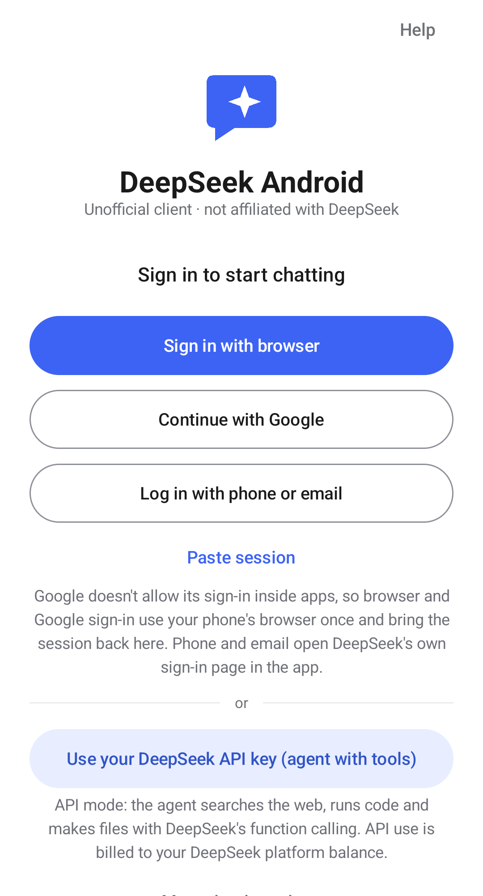
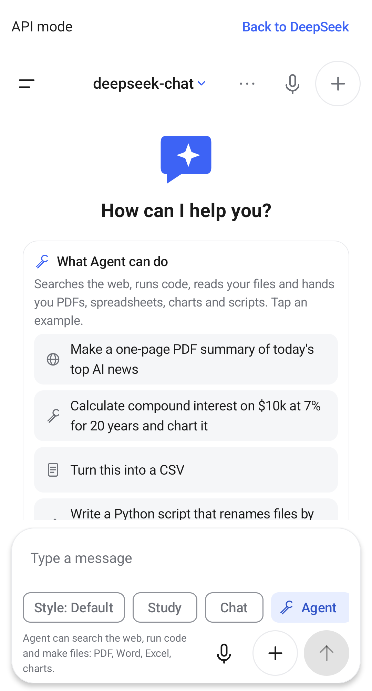
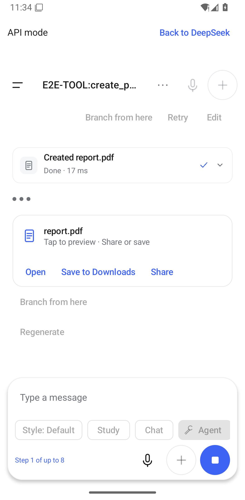
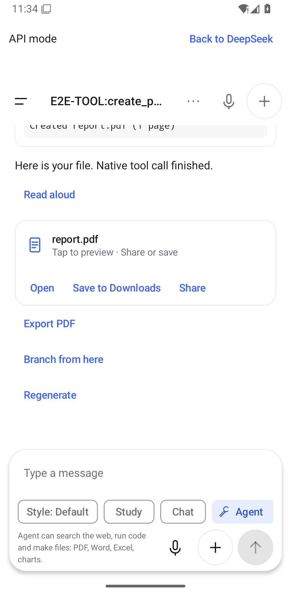

# DeepSeek Android

[](https://github.com/muhib-karim/deepseek-android/actions/workflows/ci.yml?query=branch%3Amain) [](https://github.com/muhib-karim/deepseek-android/releases/latest) [](LICENSE)

**An agent app for DeepSeek: tools, files, code, web.** Ask for a PDF, a spreadsheet, a chart or a script and get the
file; ask about today's news and it searches and reads the pages first. Open source (MIT), for Android 8.0 and newer.
**Unofficial. Not affiliated with or endorsed by DeepSeek.**

The official DeepSeek app answers in text. This app gives DeepSeek tools, as ChatGPT and Claude have them: every tool call
shows as a step you can open, and every file it makes comes back as a card you can open, share or save.

Latest release: **v1.1.0** ([release page](https://github.com/muhib-karim/deepseek-android/releases/tag/v1.1.0)).
v1.2.0 "Agent-first" is in review (below). Not independently audited. A GitHub release carries the signed, minified
release APK and SHA256SUMS.txt. Builds, unit tests, lint and emulator tests run on GitHub Actions. A 64-bit device
(arm64-v8a) is required; x86_64 is supported for emulators.

## Quick start (3 steps)

1. **Install** the APK from the [latest release](https://github.com/muhib-karim/deepseek-android/releases/latest) (check
   it against SHA256SUMS.txt).
2. **Paste your API key.** Create one at [platform.deepseek.com](https://platform.deepseek.com) (API keys), open the app,
   tap **Use your DeepSeek API key (agent with tools)** and paste it. API use is billed to your DeepSeek platform balance.
   Prefer your DeepSeek account? The sign-in buttons above it use your chat.deepseek.com account instead.
3. **Ask.** Agent is already on. Try one of the examples on the empty chat, such as *"Make a one-page PDF summary of
   today's top AI news"* or *"Calculate compound interest on $10k at 7% for 20 years and chart it"*.

## What the agent can do

- **Search and read the web:** `web_search` and `web_fetch`, with the sources it read listed under the answer. A search
  query and an unfamiliar address ask before they leave the phone.
- **Make files:** PDF, Word (DOCX), Excel (XLSX), PowerPoint (PPTX), CSV, Markdown, HTML, SVG and PNG charts and images,
  ZIP archives, and plain code files. Each arrives as a file card with **Open**, **Save to Downloads** and **Share**.
- **Run code:** JavaScript and Python (Pyodide, WebAssembly) in an isolated sandbox with no network access; native Python
  with packages and skills when you switch on Trusted execution (each run asks).
- **Read your files:** attach documents, PDFs (text extracted on the phone), spreadsheets, images (on-device text
  recognition) and photos; the agent can turn them into new files.
- **Work in steps:** up to 8 steps per reply by default (Settings > Agent > Maximum steps, 1 to 20), with a counter
  ("Step 3 of up to 8") and **Stop**, which ends the run at once and keeps the finished steps.
- **Connect tools:** remote MCP servers and skills; every tool has a switch in Plugins & tools.

## How tools work

DeepSeek's API supports function calling. In API mode the app sends the list of tools with each request, DeepSeek
answers with `tool_calls`, the app runs them on the phone and sends the results back, until DeepSeek writes the answer:

```
 you ──► app ──── messages + tools[] ────────────────► api.deepseek.com (deepseek-chat)
          ▲  ◄─── tool_calls: create_pdf({...}) ──────┘
          │  run on the phone: guard ▸ ask if needed ▸ tool ▸ file in the chat's folder
          │  ──── role "tool": {"content": "Created report.pdf"} ─►
          └─◄──── streamed answer text ───────────────┘   (up to N steps; Stop ends it)
```

- **API mode** (your API key) uses native function calling on `deepseek-chat`. DeepThink (`deepseek-reasoner`) is used
  when Agent is off, because tool turns run on the chat model.
- **Account mode** (your chat.deepseek.com account) has no function-calling API, so the app describes the tools in text
  and reads one fenced `tool` block per reply; the same agent loop, guard and approvals run both routes.
- Tool errors, unknown tools and malformed arguments go back to the model as error results; they never crash the run.
  Details: [docs/TOOLS.md](docs/TOOLS.md), [docs/AGENT_MODE.md](docs/AGENT_MODE.md).

## Privacy

- **Your API key is stored encrypted on the phone** (Android Keystore-backed EncryptedSharedPreferences) and is sent only
  to DeepSeek.
- **Calls go straight from the phone to api.deepseek.com** (or chat.deepseek.com in account mode). There is no server of
  ours in between, no analytics and no account with us.
- Other traffic happens only when a tool needs it and you allow it: web search (DuckDuckGo, or your own SearXNG), the
  pages the agent reads, and a one-time download of the Python runtime from its pinned CDN.
- Files the agent makes stay in the chat's private folder until you share or save them.
- Install-time permission: INTERNET only. Microphone and photos are asked at the moment of use.

## Screenshots

From the CI emulator run (API 34, `ApiAgentJourneyTest` and `AgentModeTest`, mocked backend), not mock-ups:

| Welcome: API key front door | Agent on, examples | Tool step card | File card |
|---|---|---|---|
|  |  |  |  |

## v1.2.0 "Agent-first" (in review, not released)

On branch `feature/v1.2.0`; versionCode 12, versionName 1.2.0. [docs/RELEASE_NOTES_120.md](docs/RELEASE_NOTES_120.md),
[CHANGELOG.md](CHANGELOG.md).

- **Agent on by default** on both routes (an existing install keeps Agent off only if you switched it off yourself), with
  an Agent pill or chip that says what it can do.
- **The API key is a front door:** "Use your DeepSeek API key (agent with tools)" on the welcome screen, and **Add API
  key** in Settings > Accounts. The API-key client is now called **API mode**.
- **Tool steps as cards**, as in ChatGPT and Claude: icon, a human title ("Searched the web: …", "Created report.pdf"),
  status, and the arguments and result on tap. File cards have Open, Save to Downloads and Share, in both modes.
- **Tool turns use deepseek-chat**; DeepThink's reasoner is used with Agent off.
- **Step counter and limit:** "Step 3 of up to 8", Settings > Agent > Maximum steps (1 to 20); Stop keeps finished steps.
- **"What Agent can do"** on an empty chat: four example prompts that fill the composer.

## v1.1.0

Released 2026-10-21 (tag v1.1.0); versionCode 11, versionName 1.1.0. Fixes what a signed-in run against the live service found,
and closes the remaining differences from the official app. GitHub Actions built and tested it;
[docs/RELEASE_NOTES_110.md](docs/RELEASE_NOTES_110.md) records the results.

- **Works with the live service again:** uploads (each with its own proof of work, sent once DeepSeek has processed the
  file), Search and DeepThink + Search replies (live stream shapes), and the first message after signing in. The proof of
  work is solved natively; no DeepSeek script runs in the app.
- **Your DeepSeek history in the drawer:** chats from other devices and the website, merged with this phone's; open one
  and continue it. Pins are shared with DeepSeek.
- **Like the official app:** thinking timeline with "Found N web pages" / "Read N pages" and site icons, numbered citation
  chips, file chips with type and size, Copy / Regenerate / Like / Dislike / Share under replies, "Create image" sharing,
  an inline attach panel with recent photos, outlined composer buttons, neutral dialogs, and no title on an empty chat.
- **Honest errors:** network, server, session and file problems say so; a transient failure is retried once and then
  offers Retry with your draft and files kept.
- **The mocked release suite now speaks the live service's shapes** (real proof of work, upload processing, Search
  streams, history), so the failures found on the live service would fail CI.

## v1.0.0

Released 2026-10-20; versionCode 10, versionName 1.0.0. [docs/RELEASE_NOTES_100.md](docs/RELEASE_NOTES_100.md).

- **Looks like the official DeepSeek app**, screen by screen, in light and dark: welcome screen with DeepSeek's terms
  box, drawer with content search and date groups, "Thought for N seconds", "Read N web pages", the Think and Search
  composer, Settings, Account settings, Data controls and Share chat. The official screens are captured by a manual
  workflow from the verified official APK and described in [docs/reference/SCREEN_SPEC.md](docs/reference/SCREEN_SPEC.md).
- **Signed out, there is no chat at all** until DeepSeek confirms the session.
- **Plugins & tools** ([docs/TOOLS.md](docs/TOOLS.md)): agent mode makes real files (code, Markdown, CSV, Word, PDF,
  Excel, PowerPoint, charts, PNG, ZIP), runs code in a sandbox (JavaScript, or Python from a pinned Pyodide runtime),
  searches and reads the web and calls remote MCP tools; every tool has a switch, and network and device actions ask
  first. Native Python and skill code need **Trusted execution** (off by default) and ask before every run.
- **File cards:** Open, Edit, Download, Save as, Share.
- **Release builds are tested before they are published:** an emulator suite drives the signed release APK against a
  local fixture with video and step screenshots, checks that every tool case happened, and a separate job loads
  DeepSeek's real sign-in page ([docs/EVIDENCE_v1.md](docs/EVIDENCE_v1.md)). From v1.0.0 a release carries only the
  signed release APK and SHA256SUMS.txt.

## v0.7.1: Sign-in fix

Fixes the blank **Log in with DeepSeek** page (DeepSeek's site now runs a security check first; the sign-in
browser mishandled it) and adds **Continue with Google** through your phone's browser, plus **Paste session**
as a fallback. Signed out, the composer no longer accepts typing; it reads "Log in to chat" and opens sign-in.
Steps and safety rules: [docs/ACCOUNTS.md](docs/ACCOUNTS.md#signing-in-with-google-v071).
Release notes: [docs/RELEASE_NOTES_071.md](docs/RELEASE_NOTES_071.md). versionCode 9, versionName 0.7.1.

## v0.7.0: Workbench

A workbench for what DeepSeek makes, and several accounts you switch between yourself:

- **Artifacts panel**: tap **Preview** on an HTML, SVG or Markdown code block, or **Open** on such a file
  the agent made. It opens full screen on phones and next to the chat on windows 840 dp and wider, with
  **Preview** and **Source** tabs. HTML runs in a sandboxed WebView (JavaScript for the artifact only, no
  file or content access, an opaque blank origin, network only after **Allow network for this preview**);
  SVG is drawn with AndroidSVG and Markdown with the app's renderer. Edit the source and tap **Run** to
  make the next version, or **Ask DeepSeek to change this**: your source and instruction go to DeepSeek as
  the next message in the same chat, and the code block in its reply becomes v2, v3, ... A version picker
  shows each version with a diff count ("+12 -3 lines").
- **Code editor**: **Edit** on code blocks and text file cards, or **Files in this chat** in the drawer,
  opens kt, py, js, ts, html, css, json, md, csv, sh, sql, xml, yaml and txt files with syntax highlighting
  from a small original tokenizer, line numbers, undo/redo, find and monospace text at your text size.
  **Save** writes the chat's folder, **Save as** uses the system file picker (no storage permission),
  **Share** sends the text and **Run** executes Python files on the phone with the existing `run_python`
  worker.
- **Accounts**: Settings → Accounts lists your DeepSeek accounts (web sign-in) and API-key profiles with
  the sign-in type, the balance where DeepSeek documents an endpoint (`GET /user/balance` for API keys,
  read when you tap Refresh; "not available" for web sign-ins) and when it was last read. One tap
  switches. Each account keeps its own encrypted credentials and its own chats.

**Manual switching only.** The app never switches, rotates or falls back to another account, not even
after a quota or rate error: it shows the error and a **Switch account** button that only opens the
list. The rule, where it is enforced and the unit test that a quota error never changes the active
account are in [docs/ACCOUNTS.md](docs/ACCOUNTS.md); release notes:
[docs/RELEASE_NOTES_070.md](docs/RELEASE_NOTES_070.md).

No new dependency and no new install permission: INTERNET plus runtime RECORD_AUDIO remain the only
ones. versionCode 8, versionName 0.7.0.

Validation: CI green on PR #23 (JVM and app unit tests, lint, debug and release builds) and 68/68
instrumented tests on an API 34 x86_64 emulator. The pass/fail table is in
[docs/RELEASE_NOTES_070.md](docs/RELEASE_NOTES_070.md). No live run against chat.deepseek.com or a real API
key has been recorded yet.

## v0.6.0: Agent

Turn on **Agent** in the composer, next to Think and Search, and DeepSeek can use tools on your
phone in the same chat:

- **On-device Python** (`run_python`): Python 3.13 with numpy and matplotlib, in a private
  folder per chat (from v1.0.0 only with Trusted execution on, asking every run; see [docs/TOOLS.md](docs/TOOLS.md)). Charts and files it creates appear as cards. Code blocks in answers get a
  **Run** button. Extra pure-Python packages install from PyPI with `pip_install`, after you
  approve each download; **Skills → Python toolsets** lists and removes them.
- **Files you can keep**: `create_pdf` lays out Markdown (headings, lists, tables, code, page
  breaks and matplotlib charts) as a PDF; `write_file` makes DOCX, CSV, Markdown, HTML, JSON or
  text. Each file is a card with a preview (PDF first page, image thumbnail or text) and **Open**,
  **Save** (Downloads) and **Share**. Every answer also has **Export PDF**.
- **Skills**: installable packs (`manifest.json`, `SKILL.md`, optional `main.py` whose functions
  become tools). Open **Skills** from the drawer or Settings to install one from an https link or a
  .zip file, enable or disable it, or remove it. Built in: `pdf-report`, `data-analysis` (CSV
  statistics and charts) and `web-summary` (reads pages with `web_fetch` and writes a cited summary).
- **Tool steps** show as compact rows you can expand to see the input and result; downloads and
  new websites ask for approval first; at most 8 model replies per request.

**Two backends, one agent loop.** With an API key, the app uses DeepSeek's native function calling
on `/chat/completions` (`tools`, streamed `tool_calls`, `tool` results). Account mode uses the free
web chat, whose session token cannot use native tools (DeepSeek's own harness requires a Platform
OAuth grant for that), so the app asks the model to end a reply with one fenced ```` ```tool ````
JSON block, runs the tool and sends the result back as the next message in the same chat.
**Trade-off:** the web protocol depends on the model following instructions (the app repairs a
malformed call once, then shows the text), each tool round trip is visible in your DeepSeek web
history, and turns are slower than native tool calls. Details, sources and the pass/fail table:
[docs/AGENT_MODE.md](docs/AGENT_MODE.md); release notes:
[docs/RELEASE_NOTES_060.md](docs/RELEASE_NOTES_060.md).

**Install a skill:** zip a folder containing `manifest.json` (`name`, `description`, `version`,
optional `tools` and `pip`), `SKILL.md` and optionally `main.py`; then **Skills → Install from
file**, or paste an https link to the .zip and choose **Install from link**. Review the tools and
packages it lists before confirming.

**APK size:** the APK bundles Python 3.13, numpy and matplotlib for arm64-v8a and x86_64, so it is
several tens of MB larger than v0.5.x. 32-bit-only (armeabi-v7a) phones are not supported from this
version. No install permission was added: INTERNET plus runtime RECORD_AUDIO remain the only ones.

Status: CI is green for v0.6.0: core and app unit tests, lint, debug and signed release builds, and
62/62 instrumented tests on an API 34 x86_64 emulator (including prompt -> `create_pdf` tool call ->
PDF artifact card, and on-device Python). A live agent turn against chat.deepseek.com with a real
account is a manual check and has not been recorded yet. Full table:
[docs/AGENT_MODE.md](docs/AGENT_MODE.md).

## v0.5.0: DeepSeek account mode

The default screen targets a DeepSeek account workflow: **Log in with DeepSeek** on
DeepSeek's own sign-in page inside the app, then native streamed chat with DeepThink and
Search controls. Settings keeps the API-key client as an explicit fallback. The light UI
follows the measured reference; dark colors and the abstract mark are original. It is an
unofficial client.

Validated for this release: CI (core and app unit tests, lint, debug and minified release
builds) and 54 emulator tests on Android 14 in light and dark themes covering all fourteen
account-mode features against a mocked DeepSeek server. The stream reader replays recorded
live DeepSeek streams (chat, DeepThink, Search) in unit tests. Sign-in, streamed chat with
proof-of-work, DeepThink, Search, history, logout and expired-token handling were checked on
the live web service with a test account.

Live result, 2026-10-18 (v0.5.1): a chat completion sent with the app's exact request
contract (bearer token, the app's client headers and a proof-of-work answer from DeepSeek's
own worker) was accepted by the live service in account mode. Real streamed replies were
recorded for a basic chat, a follow-up with DeepThink and a Search turn; rename, history and
delete also worked. The recorded streams are replayed in unit tests. Pass/fail list:
[docs/LIVE_VERIFY_051.md](docs/LIVE_VERIFY_051.md) — 12 pass, 2 not verified, 1 not
applicable.

Not verified: Google sign-in in the embedded sign-in page (no Google test account; Google
may refuse embedded browsers), and the proof-of-work step running inside the app's WebView on
a real phone (the same worker code was proven outside a WebView). File upload is not
applicable by design: the app sends extracted text and OCR, not the original files. See
[the implementation and validation boundary](docs/ACCOUNT_CLIENT_050.md) for scope and
attachment limitations. The historical feature lists below describe the API client, which
remains available through Settings.

## v0.3.0 Pass F features (in v0.3.0)

- **Voice conversation:** open Voice from the chat header, grant microphone access
  when requested, then tap Start listening. Speak → send → hear the answer → listen
  again, with the transcript saved through the existing chat flow. Tap to interrupt
  speech or stop a reply. Leaving the activity pauses voice; returning or launching
  from a shortcut never silently starts the microphone. Enable tools in the voice
  screen to use the existing per-action confirmations.
- **Read aloud:** each completed answer has sentence highlighting, pause/resume and
  a 0.5×–2× speed control. Resume repeats the interrupted sentence. English and
  Bangla use installed offline Android TTS voices. System speech recognition prefers
  on-device recognition when available; its fallback service may use the network.
- **Voice images:** take a photo through the system camera or choose Share screen,
  review the image and attach it to the next spoken turn. Existing model capability
  checks send image bytes only to vision models; text-only models receive OCR text.
  The existing Latin OCR model may not recognize Bangla text in images.
- **Phone tools:** `draft_sms`, `draft_email`, `add_calendar_event` and `open_map`
  validate inputs and ask for confirmation before opening the standard phone app.
  Sending/saving is finished there. `set_alarm` is intentionally unavailable because
  Android requires the extra `com.android.alarm.permission.SET_ALARM` permission.
- **One-shot screen capture:** Android 8–9 use fresh MediaProjection consent for
  each screenshot while this app is visible. Android 10+ require foreground-service
  permissions for MediaProjection, so only this app window is captured via PixelCopy.
  Other-app/background capture, continuous recording and protected-content capture
  are unavailable. Every image is reviewed before attaching and sending.
- **Quick launch:** New chat, Voice and Camera static shortcuts, dynamic counterparts
  within the launcher’s combined shortcut limit, a Quick Settings voice tile, and
  an `ACTION_ASSIST` entry where supported. No overlay or assistant-service permission.
- **Home-screen widget:** an Ask DeepSeek field launcher, Voice button and the latest
  active saved chat title. Temporary chats are excluded. The title is visible to
  the home-screen launcher; message bodies are never placed in the widget.
- New controls, errors and notices have English and natural Bangla resources.

No dependencies or install permissions were added. INTERNET plus runtime
RECORD_AUDIO remain the only requested permissions, with minSdk 26/targetSdk 35.
JVM tests are supplied; compilation, test execution, lint and device validation
remain CI/release gates. See [feature status](docs/FEATURE_MATRIX.md) and
[build notes](docs/BUILD_NOTES.md).

## v0.3.0 Pass E features (in v0.3.0)

- **Saved assistants:** create, edit and delete named personas with a built-in icon,
  instructions, default tools and response style. Start a chat from Assistants in
  the chat-header menu. Existing chats keep their assistant snapshot. Export JSON
  through the existing Save flow.
- **Manual accounts:** keep up to 20 DeepSeek API-key/account profiles in encrypted
  storage. Select one in Settings → Account settings or the chat-header Accounts
  picker. Quota and rate errors are shown without account switching; removing the
  selected profile leaves no other profile selected.
- **Browser agent:** watch public HTTPS pages in the in-app browser and take over
  using native controls. `open_url`, `read_page`, `click`, `type`, `submit`, `scroll`
  and `back` extend the existing registry. Every click, entry and submission shows
  its target and fields before approval. Reading follows the existing fetch policy.
  This is a restricted browser for static pages and simple forms: site scripts,
  login/password fields, cookies, remote resources and downloads are unavailable.
- **Read-only connectors:** configure a public OAuth2 PKCE provider and its search
  and item-read GET endpoints in Settings → Connectors. Sign in yourself in the
  system browser. The first call asks for access for that chat; disconnect deletes
  the encrypted local token. See [connector setup](docs/CONNECTORS.md).
- **Parallel agents:** the model supplies a plan and up to four independent tasks.
  Each gets its own read-only tool loop; a card shows individual progress. They
  share 24 inference requests and 40 tool executions, with capacity reserved for
  the parent to merge results. Stop cancels the entire group. Child agents cannot
  delegate, use the browser or write files.
- **Memory upkeep:** opt in under Settings → Memory to propose additions, edits
  and deletions after answers using recent messages from up to three saved chats.
  Review each suggestion there; nothing is applied without approval. Temporary
  chats are excluded. This uses an additional provider request.
- **Scheduled prompts:** create one-off or repeating prompts in Tasks, or approve
  the model's `schedule_prompt` call. WorkManager runs a bounded, tool-free request
  and stores its answer/error in the Tasks inbox, with an unread badge in the chat
  header. The original account must still be selected. Times are approximate,
  repeats are at least 15 minutes, and no notification or exact-alarm permission
  is used. Reopen the app after reboot or force-stop to reconcile schedules.
- New controls and notices have English and natural Bangla resources. Existing
  registry, confirmations, artifacts, export and attachment paths are retained.

WorkManager 2.9.1 is the only new dependency. No new install permission is granted;
minSdk 26 and targetSdk 35 remain unchanged. JVM coverage is included, but local
verification was static only. CI compilation/tests/lint and device validation are
still required; see [build notes](docs/BUILD_NOTES.md).

## v0.3.0 Pass D features (in v0.3.0)

- **Files out:** `create_document`, `create_spreadsheet` and `create_presentation`
  produce DOCX/XLSX/PPTX using the existing lightweight OOXML builders. `create_pdf`
  supports titles, headings, paragraphs and simple tables, sharing the conversation
  export renderer. Generated file cards offer Open and Share; external opens use FileProvider.
- **Files in:** attach up to 50 files per message through the system document picker,
  with a 20 MB per-file and 100 MB batch cap. Text, code, Office files and readable PDFs
  are extracted locally; images use the existing OCR. A compact file inventory and up to
  120,000 extracted characters go to the model. Up to four images also use vision when supported.
  The system camera intent needs no camera permission. Share text, images or PDFs from other
  apps into a new chat, review the attachments, then send.
- **Per-chat styles and Study:** choose Default, Concise, Explanatory or Formal in
  the composer. Study mode guides learning with questions and hints. Choices persist per chat.
- **Multi-file artifacts:** `create_web_project` builds a website or HTML slide deck
  with `index.html` plus CSS, classic JavaScript, SVG and JSON files. Select and edit files
  in the versioned canvas, preview offline in the existing sandbox and share/save the project as ZIP.
- **Chat ergonomics:** optional suggested follow-ups fill the composer when tapped;
  turn them off in Settings → Personalization. Temporary chats disable them. Long-press
  a message or choose Branch from here to copy its conversation prefix to a new chat.
- **Library:** browse generated files, artifacts, images and exports across chats.
  Filter by type, search by file or chat title, open/share/delete a file or jump to its source chat.
  Temporary outputs are excluded. Deletion asks first and removes that file from all chats using it.
- Every new control and notice has English and natural Bangla resources.

The existing agent registry, tool cards, confirmations, OCR, artifact history and
export paths are extended. No new dependency or install permission is added.
See [feature status](docs/FEATURE_MATRIX.md) and [build notes](docs/BUILD_NOTES.md).

## What v0.2.0 adds

- **Agent loop:** real DeepSeek function calling with tool cards in the chat, a
  confirmation sheet for anything that is not safe, Chat/Agent toggle, thinking
  display, stop, retry and edit.
- **Cited web search and fetch:** sources are numbered under the answer; fetches
  with query strings, long URLs or unseen hosts ask first.
- **Code interpreter:** a sandboxed offscreen WebView runtime with charts, an
  artifacts panel and downloadable files.
- **Image input with on-device OCR.**
- **Deep research mode:** several search/fetch rounds into a structured, cited
  report that exports as Markdown or HTML.
- **Memory and custom instructions:** saved facts you can view, edit, delete or
  switch off; global and per-chat instructions.
- **Remote tool servers:** add a public HTTPS tool server; each of its tools needs
  confirmation and can be switched off (see [SECURITY.md](SECURITY.md)).
- **Projects, temporary chat, pins, and export** to Markdown, HTML or PDF.
- **Full Bangla UI:** in-app language option plus Android per-app language.

The full feature list and what comes next are in
[docs/FEATURE_MATRIX.md](docs/FEATURE_MATRIX.md).

## v0.1 foundation

- **DeepSeek-style interface:** original chat-and-spark mark, white/near-black
  Material 3 themes with a calm blue accent, conversation drawer with search and
  Today / 30 Days / month groups, rename/delete, centered title/model picker, and a rounded
  composer with **Think**, **Search**, attach, send and stop controls. Dynamic colour
  is off. Grouped Settings, language/appearance dialogs, personalization and local
  account/data controls use original code and the supplied screenshots as references.
- **File upload:** Camera, Photo Picker and multi-document picker; up to 50
  files per message, 20 MB each (100 MB combined), copied to private storage without storage permissions. PDF,
  DOCX, XLSX and PPTX text extraction plus TXT/Markdown/CSV/JSON, capped at 200,000 characters
  per file with a truncation marker. Images become JPEG data-URI parts, at most
  1568 px, only for vision-capable models. Text-only models show an explicit
  unreadable-image chip and receive no image bytes, including from earlier turns.
- **Automatic latest models:** GET `/models` on startup, after sign-in and after
  saving settings/keys; cached by provider and endpoint. Automatic mode prefers
  creation dates, then numeric versions, with aliases last and alphabetical ties.
  A manual model choice is remembered. The picker marks **newest**; `deepseek-chat`
  is only an explicitly labelled offline fallback. Settings override vision and
  reasoning heuristics for each model.
- Streaming Markdown: headings, paragraphs, lists, quotes, horizontal rules,
  bold/italic/strike/link/code spans, bordered scrollable GFM tables and fenced
  code with Copy. Unfinished fences remain code while streaming. Inline `$math$`
  uses monospace in v0.1; full LaTeX rendering is on the roadmap.
- An ordered reasoning/tool timeline with collapsed previews, elapsed thinking
  time, human-readable tool labels, live status, and a Details sheet with
  arguments, copyable bounded results and duration. **Think** selects a reasoning
  model when available, or sends the provider's `thinking: {type: enabled}` flag.
  **Search** enables `web_search`, `visit_web` and the `web_fetch` alias for that turn.
  DuckDuckGo HTML is the default; Settings accepts a public HTTPS SearXNG URL.
- Tool calling with Markdown, RFC 4180 CSV, sanitized static SVG, PNG images and multipage A4
  text PDF artifacts, real PPTX/DOCX/XLSX makers, bar/line/pie charts, and sandbox text/ZIP tools.
- **In-app artifact previews:** PDF pages, static SVG/HTML, Markdown, CSV tables
  and images, plus Office text/table previews. Every viewer has **Share**, **Save** and
  **Open in app** through system actions. SVGs use AndroidSVG and offer PNG export.
  Table previews display up to 500 rows; exported files retain all rows.
- Plain-English authentication, quota, refusal, rate-limit and network error cards
  with **Open Settings**. One active provider/account, without automatic switching.
- A confirmation dialog with **Allow once** / **Deny**, an eight-step agent limit,
  and Stop. Keystore-backed encrypted settings; no analytics or account rotation.
- **Resilient runs:** bounded exponential retry with jitter and Retry-After, a calm
  reconnecting countdown, Retry now, durable JSON checkpoints and explicit Resume
  after restart. Completed tools are retained. Network return wakes waiting runs;
  401/403 prompts for deliberate reauthentication instead of silently retrying.
- **Dictation and language:** hold the mic for Android SpeechRecognizer; microphone
  permission is requested at first use. System/English app locales and voice language
  are selectable. Recognition availability and processing depend on the system service.
- Pure JVM `:core` for protocol, attachments, Markdown, model ranking, errors,
  agent timeline, authentication primitives, guards and tools; `:app` for Android
  UI, sign-in, encrypted storage, PDF extraction/creation and viewers.

Conversations persist as private JSON in `filesDir/conversations`; run checkpoints
live in `filesDir/runs` and artifacts in `filesDir/workspace`. Deleting a conversation
also deletes its checkpoints. Artifacts remain until deleted from Library, app data is cleared or the app is
uninstalled; Share and Save provide external copies. PDF output supports structured
text and tables; conversation exports keep Markdown punctuation as plain text.

## Connect a provider

Open **Settings → Account settings**, choose a provider, save, and return to chat.

| Provider | Configuration | Authentication |
| --- | --- | --- |
| API key | Enter your own Platform API key | `Authorization: Bearer …` |
| DeepSeek account | Configure supported authorize/exchange endpoints, then sign in | `x-dsh-auth-token`, without Bearer |
| Custom OpenAI-compatible | Base URL, model and optional separate key | Bearer key when supplied |

The default base URL is `https://api.deepseek.com`. Leave the model override blank
for automatic selection, or choose any fetched model from the title dropdown.
Custom endpoints may specify an ID in Settings even if `/models` is unavailable.
Model capabilities are heuristic and can be overridden; provider support for
vision, tool calling and the thinking flag varies. The client appends `/models`
and `/chat/completions` to the base URL; include `/v1` if the server needs it.
All configured provider endpoints require HTTPS. Calls go directly to the chosen
provider; there is no relay or automatic account switching.

### Account sign-in caveats

Authorize URL, token exchange URL and OAuth client ID **default to empty**. Until
configured the app says: **"Account sign-in endpoint not configured; use an API key"**.
No DeepSeek authorize or exchange endpoint is invented or bundled.

The configurable adapter sends a standard authorization-code request with S256
PKCE, random state, `login_source=web`, and a loopback redirect bound to
`127.0.0.1` on a random port. It opens a Custom Tab; passwords stay on the
provider's page. The token exchange is a form-encoded OAuth request and accepts
an `access_token` or `auth_token` JSON field. Configure it only for a provider
that explicitly supports this flow and its loopback redirect. The account grant
is bound to the selected inference origin; changing that origin requires sign-in
again. Removing the local grant does not revoke it on the provider's servers.

DeepSeek's harness-specific `auth_init` / `auth_exchange` / `auth_cancel` protocol
may need an additional adapter once a supported public contract is available.
This scaffold does **not** claim that third-party DeepSeek account sign-in works.
If refused or unavailable, use the first-class API-key option. It does not bypass
provider restrictions, spoof another app, rotate accounts or pool credentials.
Account inference may draw on Platform balance or bonuses; it is **not unlimited
free chat**. Tokens may expire; automatic refresh and remote revocation are not
implemented in v0.1.

Client identity headers explicitly identify **DeepSeek-Android-Unofficial**, its version, Android platform,
language and UTC offset. Their provider-specific acceptance remains to be
verified against a supported integration. Inference and token-exchange redirects
are refused to avoid forwarding credentials to a different origin.

## Safety and permissions

**INTERNET is the only install-time permission.** RECORD_AUDIO
is declared and requested at first dictation use. Since v1.1.0, photo access (READ_MEDIA_IMAGES;
READ_EXTERNAL_STORAGE up to Android 12L) is declared for the attach panel's recent-photos strip and
requested only when you tap Recent photos. ACCESS_NETWORK_STATE is explicitly removed during manifest
merging. There are no write-storage, notification, install, location or broad package-query permissions.
Artifacts live under the app's private `filesDir/workspace` directory. The
non-exported FileProvider exposes only artifact directories and a narrow camera
cache directory. Camera uses the system intent without CAMERA permission. Uploads
live under private `files/uploads`; they are copied immediately, so persistable
URI permission is not taken. Imported copies are deleted after message preparation or when discarded; only
the prepared text/image context remains in the private persisted conversation. Exports use the Storage Access
Framework. Images go through on-device OCR; PDF text extraction does not OCR
scanned pages, so scanned PDFs may contain no readable
text, and encrypted/damaged files can be rejected.

Known, safe workspace tools are allowed. Unknown tools are denied. Reads stay
inside the workspace; path traversal, encoded path tricks and symlinks are
rejected. Built-in writers create new files and never silently overwrite existing
ones. Guard policy requires confirmation for writes outside the workspace, but
v0.1 built-ins cannot perform those writes; the user exports through Save as….
Shell/install policy toggles default off and require confirmation every time when
enabled. No shell/install tools are actually registered in this scaffold.

Web fetch accepts public HTTPS only, checks IP literals and resolved addresses,
disables proxies and redirects, and limits responses to 2 MB with a 20-second
call timeout. HTML extraction is intentionally simple. Fetched text remains
untrusted and may contain prompt injection; the guard checks subsequent tool
calls regardless of model instructions. SVG output uses a conservative element
and attribute allowlist; scripts, event handlers, styles, external references,
DTDs and processing instructions are removed or rejected. AndroidSVG renders sanitized
SVG without external resources. HTML canvas previews permit sandboxed JavaScript,
with no native bridge, file/content access, device permissions or navigation.
Networking starts blocked and requires a separate confirmation for single-file HTML.
Multi-file projects stay offline; their exact local resources are intercepted without
network access. See SECURITY.md for the full preview policy. CSV cells follow RFC 4180; spreadsheet applications
may interpret formula-like cells when opened, so review untrusted CSVs there.

Do not send secrets in chat or model-generated tool arguments. Prompts, reasoning,
tool results and fetched text can be transmitted to the provider you configure.
See [SECURITY.md](SECURITY.md) for limitations and reporting guidance.

## Build and download

No Gradle wrapper JAR is committed. Dependencies use a version catalog with
AGP 8.7.2, Kotlin/Compose plugin 2.0.21 and Gradle 8.10.2 in CI, using JDK 17 and
Android compile/target SDK 35. Since v0.6.0 the Chaquopy plugin (17.1.0) builds the on-device
Python: the build machine needs Python 3.13 on PATH (`python3.13`; CI installs it with
actions/setup-python), and Chaquopy downloads its runtime and the numpy/matplotlib wheels during
the build.

1. Push to `main` or open a pull request targeting `main`.
2. In **Actions → CI**, inspect tests and lint, then download
   **deepseek-android-debug-apk**. Failure reports are attached when available.
3. Version tags matching `v*` trigger the APK release workflow. Download
   `deepseek-android-<tag>-debug.apk` from **Releases**.

CI runs:

```sh
gradle --no-daemon :core:test :app:testDebugUnitTest :app:lintDebug :app:assembleDebug :app:assembleRelease
```

The separate secret scan runs Gitleaks 8.21.2 in Docker; it does not use the
license-gated Gitleaks action. Debug APKs use Android's automatically generated debug
key: **debug-key signed, not audited**. Signed release APKs are optional and do not
imply a security audit. CI also checks the merged release manifest for unexpected
permissions. Emulator tests run separately and require the action pin listed in
BUILD_NOTES before their first run.

## Install and verify

1. Open the repository **Releases** page and download the APK assets and
   `SHA256SUMS.txt` from the same release into one directory.
2. Verify them before installation:

   ```sh
   sha256sum -c SHA256SUMS.txt
   ```

   Every downloaded APK must report `OK`. The checksum file lists all APKs on that
   release; download both variants if both are listed, or expect a missing-file
   warning for the variant you did not download. Checksums detect damaged or changed
   files; obtain the checksum file from the trusted release page too.
3. Open your chosen APK on Android 8.0 or newer and approve installation in the
   system installer. The app itself requests no package-install permission.

`deepseek-android-<tag>-debug.apk` is the testing build: **debug-key signed, not
audited**. `deepseek-android-<tag>-release.apk`, when present, is R8-minified,
resource-shrunk and signed with the maintainer key supplied through CI secrets.
Without signing secrets the release publishes debug plus its checksum; PR CI
still compiles the unsigned, minified release variant.

Different debug runs may use different signing keys. Switching between debug and
release keys can require uninstalling first, which clears app data. Use
**Settings → Backup → Export backup** before uninstalling, and save generated
files separately. Restore merges records after confirmation; existing IDs win,
preferences are restored and imported schedules stay paused. Credentials and
provider/connector configuration must be entered separately. Keep the unencrypted
backup private. The latest release is 0.7.0 (versionCode 8).

## More screenshots

The v1.2.0 screenshots at the top of this page come from the emulator workflow's `emulator-smoke` artifact
(`smoke-screenshots/`); the light and dark official-style screens are in its `official-ui-screenshots` artifact. No
generated or mock screenshots are included.

## Tests and remaining validation

Tests cover SSE framing, streamed tool calls, OpenAI string/multipart wire models,
model discovery/ranking/capability overrides, auth headers, PKCE, callbacks, guards,
workspace paths, CSV/SVG, web URL policy and agent continuation/denial/cancellation.
Pass 2 adds in-memory DOCX fixtures, bounded text/charset handling, attachment
context, Markdown blocks/inlines/streaming, quota/status errors, CSV preview parsing,
and reasoning → tool → reasoning → tool → answer ordering and status updates.
MockWebServer fixtures cover `/models`, thinking flags, errors and streaming.
Pass 3 adds Office package integrity and extraction fixtures, traversal-safe ZIP tests,
chart/search fixtures, retry/checkpoint/cancellation/session tests, conversation recovery
and store tests, and image-tool sanitization tests.

Tests were authored first but have not been executed locally. See
[docs/PASS3.md](docs/PASS3.md) for source checks and remaining CI/device validation.
Device validation is still needed for pickers, camera handoff, PDFBox extraction,
PDF/AndroidSVG/Office previews, dictation/locales, reconnecting, sharing/export, configuration changes, large fonts and
light/dark layouts. No first-build success or screenshot parity is claimed.

## Roadmap

- v0.7.1 "Sign-in fix" released 2026-10-20: blank sign-in page fixed, Continue with Google through the
  browser, Paste session, signed-out composer locked; see [RELEASE_NOTES_071.md](docs/RELEASE_NOTES_071.md).
- v0.7.0 "Workbench" released 2026-10-20: artifacts panel with edit-and-rerun, code editor and
  account manager with manual switching; see [RELEASE_NOTES_070.md](docs/RELEASE_NOTES_070.md).
- v0.3.0 delivered every row in [FEATURE_MATRIX.md](docs/FEATURE_MATRIX.md).
- v0.4.0 released (Pass G): signed minified release APK, SHA256SUMS.txt, emulator
  smoke tests, accessibility changes, local backup/restore and local diagnostics.
  Real-device validation and screenshots remain pending.
- Full LaTeX rendering and OCR for scanned PDF pages.
- Supported account-provider adapter, token lifecycle and integration validation.
- Device tests for PDFs, encrypted preferences and system document actions.

## Credits and license

The protocol and safety design follows
[deepseek-ai/deepseek-harness](https://github.com/deepseek-ai/deepseek-harness)
(MIT; Copyright DeepSeek). This implementation is original. No code from other
unlicensed projects is included. See [NOTICE](NOTICE), [LICENSE](LICENSE),
[docs/PLAN.md](docs/PLAN.md), and [SKILLS_USED.md](SKILLS_USED.md).
