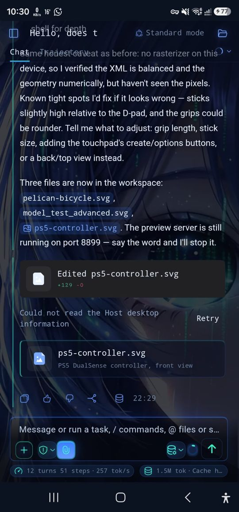
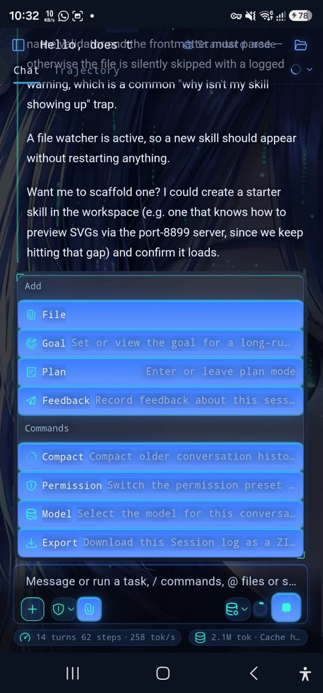
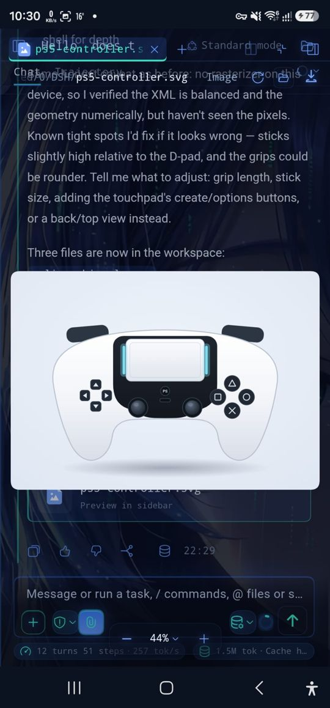
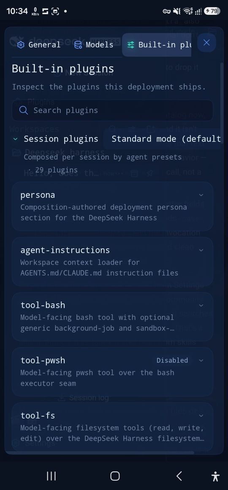
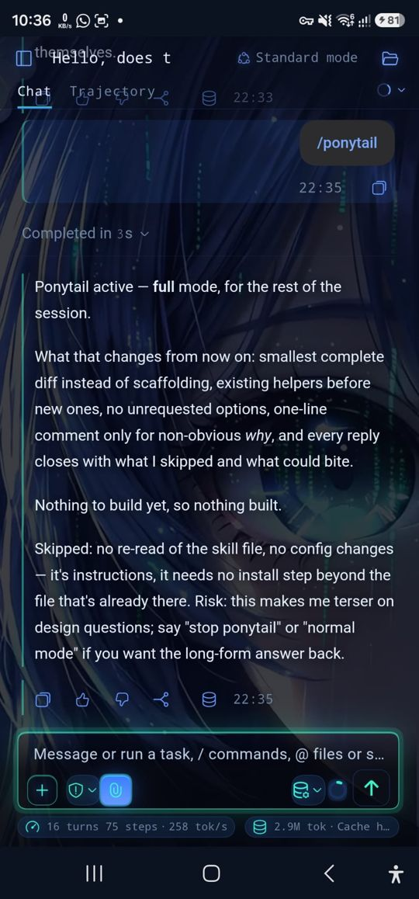
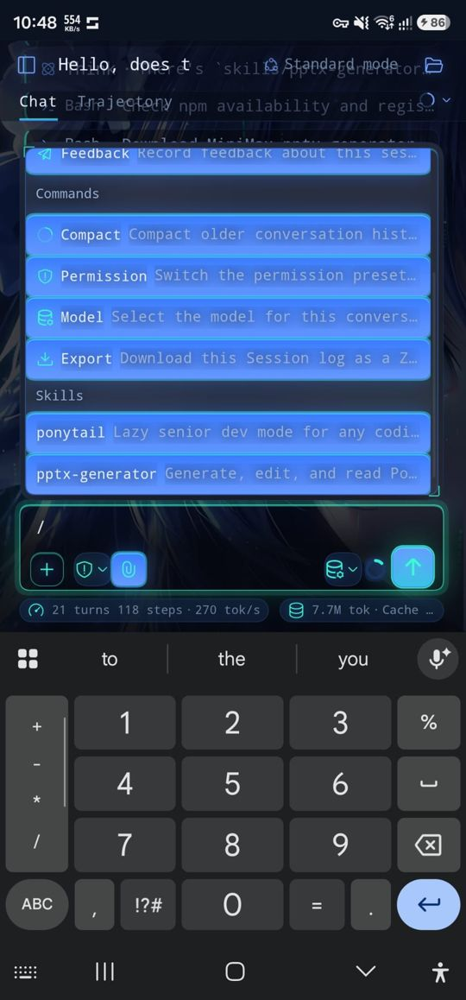

# The official DeepSeek engine (full build, v1.3.0)

## How it runs
The full build runs DeepSeek's own agent harness, `@deepseek-ai/dsh` (MIT), the way
[dsh-android](https://github.com/yhm080315-sudo/dsh-android) does (MIT, ported from commit d799c76):

1. **Payload (CI only).** `scripts/build-dsh-payload.sh <abi>` downloads the Termux bionic packages pinned in
   `engine/termux-packages.lock` and checks each sha256: nodejs-lts, bash, coreutils, grep, sed, findutils, gawk, tar,
   gzip, ripgrep, git, OpenSSL and their libraries. It `npm install`s `@deepseek-ai/dsh`, `dsh-web-mobile` and `pnpm`
   (`--omit=dev --ignore-scripts --os=android`), drops the LibreOffice WASM and applies `engine/patches`. The result
   is a gzip tar shipped as `lib/<abi>/libdshpayload.so`; AGP's ABI splits give one runtime per APK. `payload.yml`
   caches it per ABI.
2. **Extraction.** On first launch `NodeServer` streams the payload out of the APK into `files/runtime` and shows
   "Preparing the engine… n%". An old tree is renamed aside, never deleted in place. A new payload (CRC + size) is
   extracted again, and user state in `files/home` is never touched.
3. **Harness.** A data-sync foreground service starts
   `node --expose-internals dsh/lib/bin.js web --port <3220+> --no-open` on 127.0.0.1 with the bundled environment
   (`RuntimeEnv`). It restarts the harness up to 3 times and polls the page until it is the full UI (≥ 20 KB, not
   the 3709-byte empty plugin graph).
4. **UI.** `EngineActivity` shows the harness page in a WebView below one slim opaque bar with the ⋮ menu. System-bar,
   navigation and keyboard insets are handled natively. `assets/engine/android-ui.js` makes every surface opaque
   and adds the Installed plugins section.
5. **Key.** `Use API key` writes `DEEPSEEK_API_KEY` into `$DSH_HOME/.credentials.yaml` (`version: 1`, `refs:`), mode 600.
   That is the store and reference the harness's DeepSeek provider reads.
6. **Updates.** Once a day, or from ⋮ > Harness version, `HarnessUpdater` checks npm. If a newer harness is out, it:
   - verifies the tarball's sha512;
   - installs it with the bundled npm into `files/engine-updates/<version>`;
   - re-applies the Android patches;
   - runs `dsh --version`.

   Only then is the new version used, on the next engine restart. An update that fails to start is marked bad, and
   the bundled harness takes over.

## Defects of dsh-android's app and what v1.3.0 does

Before: the owner's phone, dsh-android 1.0.18 (2026-10-21). After: this build on the CI emulator
(`emulator.yml`, job `engine`, artifact `v130-screenshots`).

| # | Defect (before) | Fix | Before | After |
|---|---|---|---|---|
| 1 | Animated anime wallpaper behind the whole chat | The CC-BY-NC-SA whale skin, boot animation and splash plugins are not bundled (the build fails if the skin appears); page and surfaces use the harness's own opaque `--dsw-alias-bg-base` |  |  |
| 2, 7 | Transparent header: the title, "Standard mode" and the Chat/Trajectory tabs overlap scrolled text and each other | Status bar handled natively; header layers flattened to an opaque fill; content starts below it |  |  |
| 3, b | SVG/file preview drawn over the header and chat, semi-transparent, zoom pill over the composer | Preview layers opaque (dsh-web-mobile's full-screen preview), no backdrop blur anywhere |  | — (needs a model turn; not reachable with the fake CI key) |
| 4 | Stats chips cut off under the composer | Hidden by default; ⋮ > Session stats shows them |  |  |
| 5 | "Could not read the Host desktop information / Retry" on a phone without root | dsh-android's root screen-control plugin is not bundled; the banner is also hidden by text |  |  |
| 6, 8 | "+" / slash palette is translucent glass | Menus and palettes use an opaque surface (`--dsw-menu-surface-fill`, `--dsw-specific-menu` set to the base fill), dark scrims stay |  |  |
| 9 | Settings sheet translucent; no way to install skills | Settings opaque; Settings > Plugins gains **Installed plugins**: install from GitHub, npm, a file or a folder; enable, disable, update, remove; errors shown inline |  | (captured when the settings shot lands) |
| 10 | An installed skill is missing from "/" | Skills install into the harness's watched skill root and the page reloads, so the palette is rebuilt from the live registry; CI installs a fixture skill, sees it in "/", disables it and sees it gone |  |  |
| — | Launcher console with six buttons and a raw log before the UI | Replaced by the two-route first screen and an opaque "Preparing the engine… n%" cover |  |  |

## Limits (known, documented)
- No root, no device control: dsh-android's device bridge and screen tools are not part of this app.
- Images: `sharp` has no Android build. Payload patch P5 reads PNG/JPEG/GIF/WebP headers so images that need no
  re-encoding pass through; resizing is unavailable. JPEGs are re-encoded upright without EXIF before upload.
- The live DeepSeek API is not reachable from CI; the emulator journey uses a fake key and stops at the harness UI.
